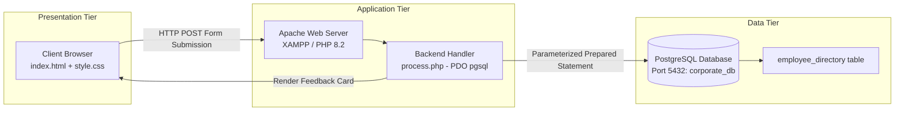
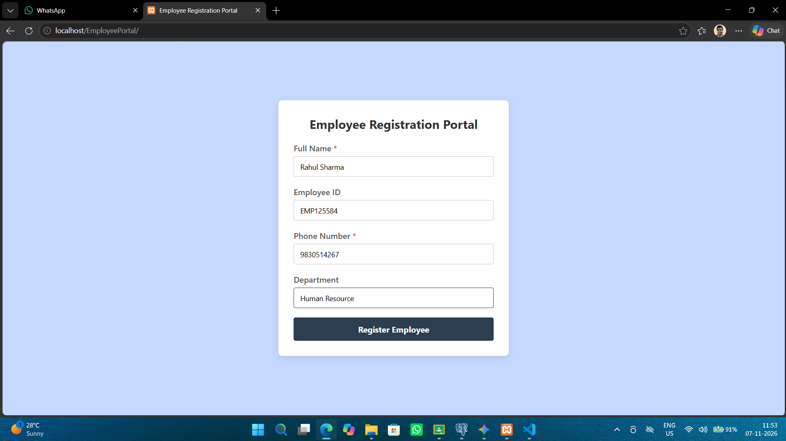
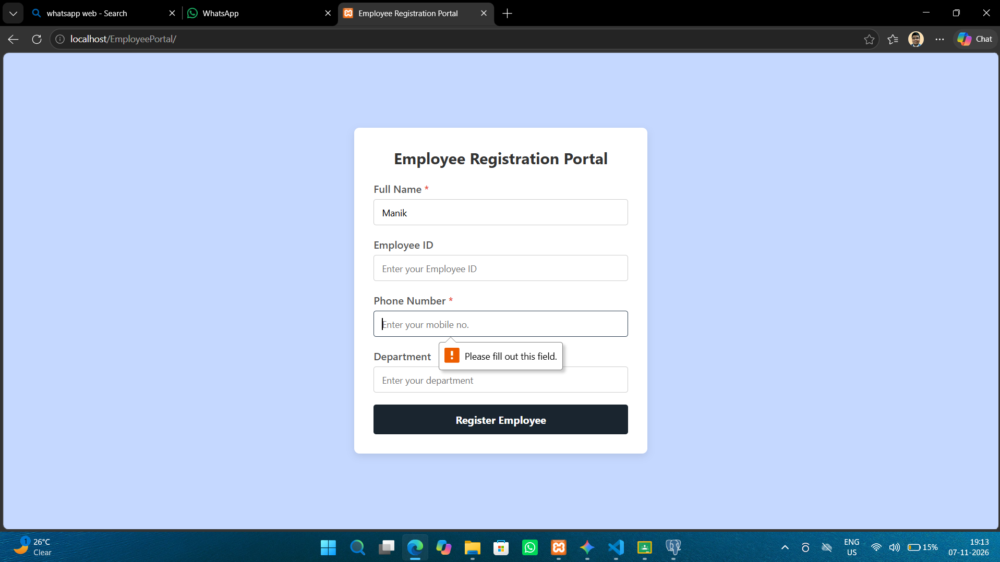
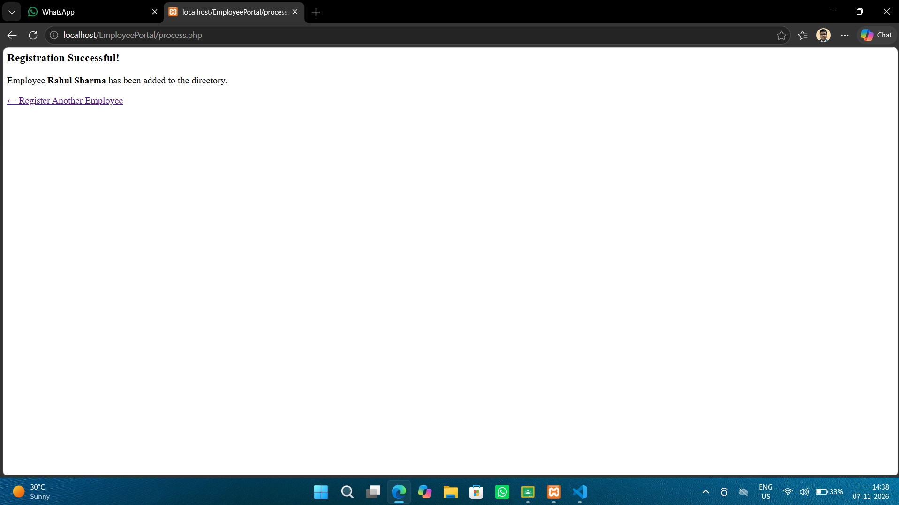
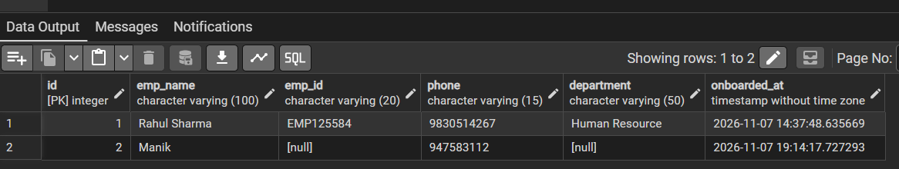
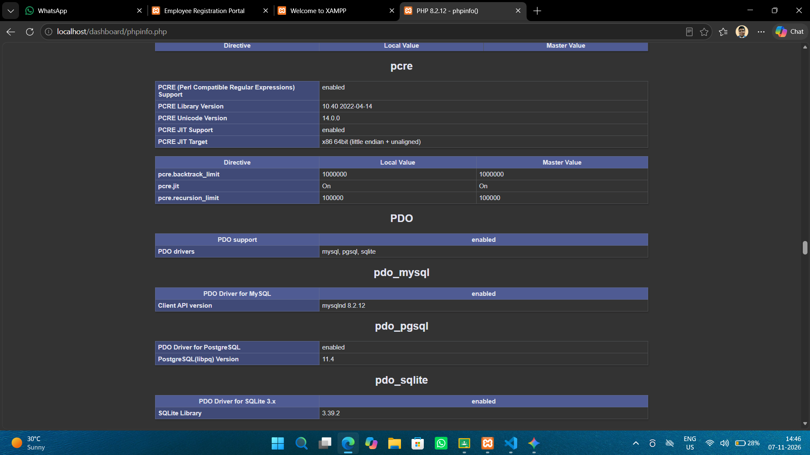
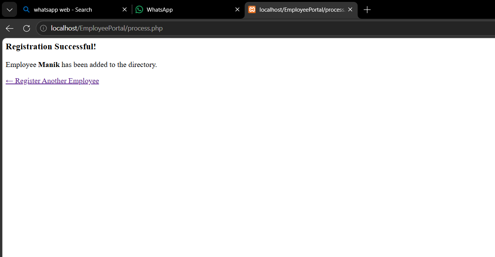
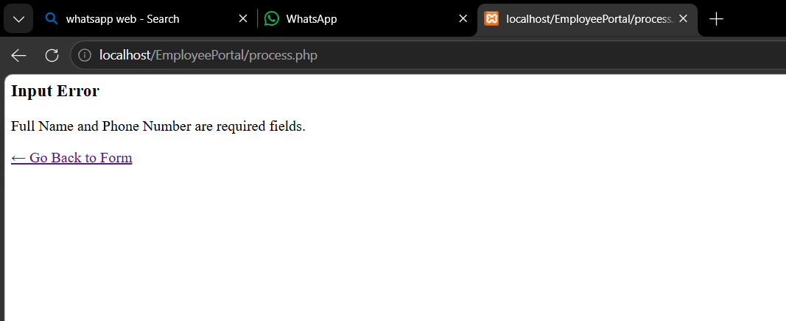

# 🏢 Employee Registration Portal

[](https://www.php.net/)
[](https://www.postgresql.org/)
[](https://www.apachefriends.org/)
[](https://www.php.net/manual/en/book.pdo.php)
[](https://developer.mozilla.org/)

A lightweight, robust 3-tier web application designed to securely capture, validate, and persist corporate personnel records into a relational **PostgreSQL** database instance. The application features dual-layer validation (HTML5 client-side and PHP server-side guards), protection against SQL injection via **PDO parameterized queries**, XSS mitigation, and automated timestamp tracking for employee onboarding.

---

## 📑 Table of Contents

- [Project Overview](#-project-overview)
- [System Architecture](#-system-architecture)
- [Key Features](#-key-features)
- [Screenshots & Visual Walkthrough](#-screenshots--visual-walkthrough)
- [Tech Stack](#-tech-stack)
- [Database Schema](#-database-schema)
- [Prerequisites & Environment Configuration](#-prerequisites--environment-configuration)
- [Installation & Getting Started](#-installation--getting-started)
- [Security & Error Handling](#-security--error-handling)
- [Project Directory Structure](#-project-directory-structure)
- [Course Information & Author](#-course-information--author)

---

## 🌟 Project Overview

The **Employee Registration Portal** provides human resources and department administrators with a streamlined, reliable interface to register employees into a centralized company directory (`corporate_db`). 

Developed as part of the **Database Management System Laboratory (CS506)**, this project demonstrates end-to-end full-stack database integration using native PHP Data Objects (PDO) connected to a PostgreSQL backend on port `5432`.

---

## 🏛️ System Architecture

The application adopts a classic, decoupled 3-tier architecture:



1. **Presentation Tier (Frontend):** Responsive HTML5 form styled with custom CSS (`style.css`), featuring input constraints, focus styling, and user feedback states.
2. **Application Tier (Backend):** PHP processing script (`process.php`) that establishes a PDO database connection, enforces server-side validation rules, and dispatches parameterized SQL statements.
3. **Data Tier (Database):** Local PostgreSQL service persisting structured employee data with relational constraints and auto-generated audit timestamps.

---

## ⚡ Key Features

- **Dual-Layer Validation:**
  - *Client-side:* HTML5 `required` attributes and input types (`type="tel"`, `type="text"`) prevent incomplete submissions directly in the browser.
  - *Server-side:* Strict conditional checks in PHP verify essential fields before any database query is executed.
- **SQL Injection Prevention:** Implements PDO prepared statements with parameter binding (`:emp_name`, `:emp_id`, `:phone`, `:department`), isolating user input from executable query syntax (mitigating CWE-89).
- **Cross-Site Scripting (XSS) Sanitization:** All echoed server responses utilize `htmlspecialchars()` to escape potential injection attacks (mitigating CWE-79).
- **Graceful Error Handling:** Dedicated `try-catch` blocks distinguish between database-level exceptions (`PDOException`) and application/validation logic exceptions (`Exception`).
- **Audit Logging:** Database schema automatically captures the exact record creation timestamp (`onboarded_at`) using `DEFAULT CURRENT_TIMESTAMP`.
- **Responsive UI:** Clean, minimalist card interface with modern typography, subtle box shadows, accessible form labels, and color-coded status banners.

---

## 📸 Screenshots & Visual Walkthrough

### 1. Registration Interface
Clean, centered card UI with clear required indicators:


### 2. Client-Side Input Validation
HTML5 validation triggers when required fields (Full Name, Phone Number) are missing:


### 3. Submission Confirmation
Success feedback banner rendered dynamically upon database insertion:


### 4. Database Verification (pgAdmin 4)
Verified records stored in PostgreSQL `employee_directory` table with auto-generated IDs and timestamps:


### 5. PDO PostgreSQL Driver Verification
PHP environment confirmation showing enabled `pdo_pgsql` driver in `phpinfo()`:


### 6. Edge Cases & Exception Handling
- **Missing Required Fields / Incomplete Submission:**
  

- **Parameter Discrepancy / Input Error Handling:**
  

---

## 🛠️ Tech Stack

| Component | Technology | Description |
| :--- | :--- | :--- |
| **Frontend** | HTML5, CSS3 | Semantic markup, responsive card layout, modern form styling |
| **Backend** | PHP 8.2+ | Server-side script handling POST requests and validation |
| **Database Abstraction** | PHP PDO (`pdo_pgsql`) | Secure database abstraction layer with prepared statements |
| **Database** | PostgreSQL 11+ | Relational database system running on localhost:5432 |
| **Database GUI** | pgAdmin 4 | Database administration and data verification tool |
| **Local Server** | Apache (via XAMPP) | Local web server environment |

---

## 🗄️ Database Schema

### Table: `employee_directory`

The table resides within the `corporate_db` database:

| Column | Data Type | Constraints | Description |
| :--- | :--- | :--- | :--- |
| `id` | `INTEGER` | `PRIMARY KEY`, `SERIAL` | Unique auto-incrementing employee record identifier |
| `emp_name` | `VARCHAR(100)` | `NOT NULL` | Employee's full name (Mandatory) |
| `emp_id` | `VARCHAR(20)` | `NULLABLE` | Official company employee ID code (Optional) |
| `phone` | `VARCHAR(15)` | `NOT NULL` | Contact telephone / mobile number (Mandatory) |
| `department` | `VARCHAR(50)` | `NULLABLE` | Assigned organizational department (Optional) |
| `onboarded_at` | `TIMESTAMP` | `DEFAULT CURRENT_TIMESTAMP` | System-generated registration timestamp |

### SQL DDL Script

Run the following SQL in your PostgreSQL query tool (e.g., pgAdmin 4 or `psql`):

```sql
-- 1. Create the Database
CREATE DATABASE corporate_db;

-- 2. Connect to the Database
\c corporate_db;

-- 3. Create the Employee Directory Table
CREATE TABLE employee_directory (
    id SERIAL PRIMARY KEY,
    emp_name VARCHAR(100) NOT NULL,
    emp_id VARCHAR(20),
    phone VARCHAR(15) NOT NULL,
    department VARCHAR(50),
    onboarded_at TIMESTAMP WITHOUT TIME ZONE DEFAULT CURRENT_TIMESTAMP
);
```

---

## ⚙️ Prerequisites & Environment Configuration

Ensure you have the following installed on your machine:
1. **XAMPP** (or standalone Apache + PHP 8.x).
2. **PostgreSQL** Server (running on port `5432`).
3. **pgAdmin 4** (or `psql` CLI).

### Enabling PostgreSQL Extension in PHP

By default, XAMPP may not have PostgreSQL PDO drivers enabled. To enable them:

1. Open your `php.ini` file (found in `C:\xampp\php\php.ini` or via XAMPP Control Panel > Apache > Config > `PHP (php.ini)`).
2. Search for the following lines:
   ```ini
   ;extension=pdo_pgsql
   ;extension=pgsql
   ```
3. Uncomment them by removing the leading semicolon (`;`):
   ```ini
   extension=pdo_pgsql
   extension=pgsql
   ```
4. Save `php.ini` and **Restart Apache** from the XAMPP Control Panel.
5. Verify that `pdo_pgsql` appears under the PDO section by opening `http://localhost/dashboard/phpinfo.php`.

---

## 🚀 Installation & Getting Started

### 1. Clone or Copy the Repository
Clone the repository directly into your XAMPP web root directory (`htdocs`):

```bash
cd C:\xampp\htdocs
git clone https://github.com/aritrachakraborty2909-hub/EmployeePortal.git
```

### 2. Configure PostgreSQL Database
1. Launch **pgAdmin 4** or connect via `psql`.
2. Execute the DDL script provided in the [Database Schema](#-database-schema) section to create `corporate_db` and `employee_directory`.

### 3. Update Connection Credentials
Open `process.php` and verify or update your database connection parameters:

```php
$host     = 'localhost';
$port     = '5432';
$db       = 'corporate_db';
$user     = 'postgres';      // Your PostgreSQL username
$password = 'your_password';  // Your PostgreSQL password
```

### 4. Launch the Application
1. Start the **Apache** server in the XAMPP Control Panel.
2. Ensure your **PostgreSQL** service is running.
3. Open any modern web browser and navigate to:
   ```
   http://localhost/EmployeePortal/index.html
   ```
4. Enter the employee details and click **Register Employee**.

---

## 🔒 Security & Error Handling

- **Prepared Statements (CWE-89 Defense):**
  ```php
  $sql = "INSERT INTO employee_directory (emp_name, emp_id, phone, department) 
          VALUES (:emp_name, :emp_id, :phone, :department)";
  $stmt = $pdo->prepare($sql);
  $stmt->execute([
      ':emp_name'   => $emp_name,
      ':emp_id'     => $emp_id,
      ':phone'      => $phone,
      ':department' => $department
  ]);
  ```
  Data values are sent separately from the query command, making SQL injection impossible even if inputs contain reserved SQL characters or payloads.

- **Cross-Site Scripting Mitigation (CWE-79 Defense):**
  ```php
  echo htmlspecialchars($emp_name);
  ```
  Prevents stored or reflected XSS vulnerabilities when presenting feedback to users.

- **Granular Exception Handling:**
  Separate `catch` blocks catch `PDOException` for database connection/constraint issues and generic `Exception` for missing required inputs, ensuring user-friendly error cards without exposing server internals or stack traces.

---

## 📂 Project Directory Structure

```plaintext
EmployeePortal/
├── index.html                   # Frontend registration form with HTML5 validation
├── process.php                  # Backend PHP script handling validation, PDO, & SQL insertion
├── style.css                    # Responsive CSS stylesheet for card UI and status states
├── README.md                    # Project documentation and setup guide
├── Report.pdf                   # Lab report documentation with test execution records
└── Screenshots/                 # Test results and verification screenshots
    ├── driver.png               # phpinfo() verification showing pdo_pgsql driver enabled
    ├── frontend.png             # Initial employee registration form view
    ├── mismatched_error.png     # Verification of error handling on key discrepancy
    ├── partial_submission.png   # Verification of partial submission with optional fields
    ├── required_input.png       # HTML5 required field validation tooltip in action
    ├── sql_table.png            # pgAdmin 4 view of records in employee_directory table
    └── success.png              # UI view of successful registration card
```

---

## 🎓 Course Information & Author

- **Author:** Aritra Chakraborty
- **Department:** Computer Science & Engineering (CSE)
- **Semester:** 5th Semester
- **Roll No.:** 20
- **Course:** Database Management System Lab (`CS506`)
- **Assignment:** Assignment 6
- **Repository:** [aritrachakraborty2909-hub/EmployeePortal](https://github.com/aritrachakraborty2909-hub/EmployeePortal)
